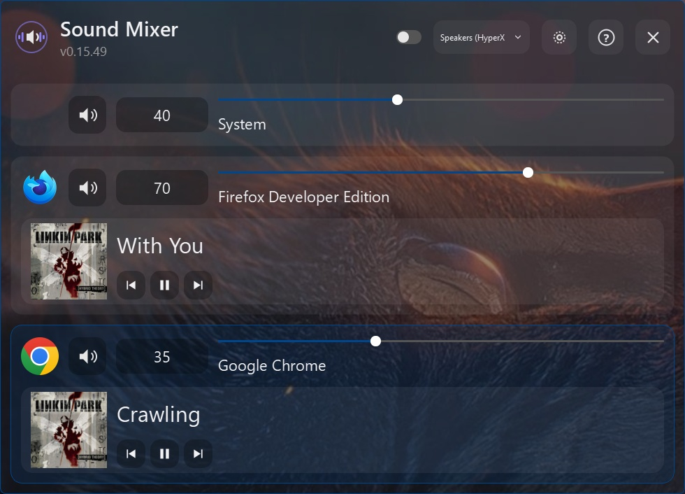
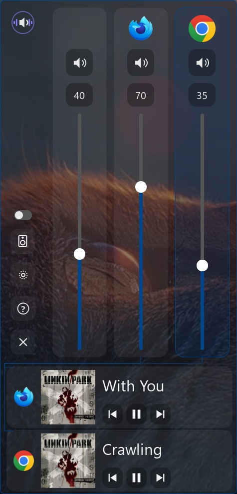

# Windows Sound Mixer

[](https://github.com/microsoft/winget-pkgs/tree/master/manifests/g/GetItSimple/SoundMixer)

A per-application volume mixer for Windows. Adjust the volume of any running
program with an audio session, or the system volume, from a small always-on-top
overlay, the system tray, or global hotkeys.





## Install

Install with WinGet:

```powershell
winget install --id GetItSimple.SoundMixer --exact --source winget
```

You can also download an installer or standalone `SoundMixer.exe` from
[GitHub Releases](https://github.com/get-it-simple/Windows-Sound-Mixer/releases).
The user installer works without administrator permissions. The machine
installer installs for all users and requests administrator approval.

<details>
<summary>Running from source</summary>

With Python installed, run these commands from the project directory:

```powershell
pip install -r requirements.txt
python -m sound_mixer
```

</details>

<details>
<summary>Features</summary>

## Everyday controls

- Press **Ctrl+Alt+NumPad 5** to show or hide the overlay. You can change this
  shortcut in **Settings > Hotkeys**.
- Adjust an application's slider or use the mouse wheel to change its volume.
  Use its mute control to mute or unmute it.
- Use the arrow keys to move between entries and adjust the selected volume;
  their direction follows the horizontal or vertical layout.
- Select an audio output in the overlay to change the Windows playback device.
  Wait for switching to finish before choosing another device.
- Open Settings from the overlay or system tray to change shortcuts, layout,
  language, scaling, transparency, and startup behavior.

## Features

- Independent volume and mute controls for each application and the system.
  Changes made in the Windows mixer are reflected in Sound Mixer.
- Saved volume levels, shortcuts, window positions, and preferences.
- Horizontal and vertical overlay layouts with separate sizes and positions.
- A transparent mini widget with optional system volume and screen-edge docking.
- Up to nine named volume presets, with optional shortcuts and application isolation.
- Application lists for hiding apps, showing only selected apps, and arranging
  their order in both widgets.
- Adjustable interface scale, volume steps, tooltip delay, and transparency,
  including acrylic blur on supported Windows versions.
- Optional launch at Windows login and an option to show the overlay on startup.
- Optional background scanning for audio applications started through selected
  launchers or sandboxes. Enable it when these applications do not appear normally.

### Mini widget and display scaling

Enable the mini widget in Settings. Scroll over an application to adjust its
volume and click it to toggle mute. Drag its pin close to a screen edge and
release to dock it; drag away to undock. Left and right docking show a vertical
application list, while top and bottom docking keep the horizontal view.

The mini widget has its own selected entry, shown with a colored border.
Configure its navigation, volume, visibility, and system-volume shortcuts in
**Settings > Hotkeys**; they are unassigned by default. Navigation and volume
shortcuts work while the mini widget is visible. Its selection is independent
of the main overlay and resets when Sound Mixer restarts.

The mini widget can optionally appear above the taskbar. Its position, docking,
scale, transparency, and system-volume visibility are saved between runs.

Overlay and mini widget scaling is capped at 300% including Windows display
scaling. At 200% Windows scaling, each widget allows up to 150%. Your preferred
scale is saved and adjusted to the current screen when needed.

</details>

<details>
<summary>Extra details</summary>

## Volume presets

Open **Settings > Presets** and use the plus button to create a preset. Give it
a name, drop local `.exe` files or application shortcuts into its card, and set
application and system volume or mute levels. Select **OK** to save your edits;
**Cancel** discards them.

Activate a preset from its card or the overlay's P1–P9 indicator. Hover over the
indicator to see the preset name, or click it to choose another preset or
**Normal mode**. You can also assign global shortcuts under **Hotkeys**:
pressing a preset's shortcut again returns to normal mode. Shortcuts pause while
Settings is open. The last active mode is restored on startup.

While a preset is active, volume changes update that preset. Applications not
included in it use their normal levels. Returning to normal mode restores your
normal application and system levels. Deleting an active preset also returns
to normal mode. Closing Sound Mixer leaves the current Windows volume levels
in place.

Each preset can isolate one application. Other applications are held at 0%,
including hidden apps and newly started audio sessions, while their saved levels
are preserved. Their volume controls are disabled during isolation. Attempts
to change their volume are reverted and may show a Windows notification.
Removing the isolated application from the preset or excluding it from the
allowed application list clears isolation; temporarily closing it does not.

## Settings and saved data

Settings are saved automatically in a human-editable `settings.json` file:

- **Installed or standalone executable:**
  `%LOCALAPPDATA%\GetItSimple\SoundMixer\settings.json`.
- **Portable mode:** launch `SoundMixer.exe --portable` to keep settings next to
  the executable. If that folder is not writable, Sound Mixer uses the location
  above instead.
- **Running from source:** settings stay in the project directory.

Close Sound Mixer before editing the file by hand. Existing settings are
migrated automatically when their format changes, including older settings
stored beside the executable.

| Settings group | What it stores |
| --- | --- |
| `version` | Settings format version, updated automatically. |
| `master_volume`, `master_muted`, `app_volumes` | Normal system and application volume/mute levels. |
| `presets`, `active_preset_id`, `isolation_restore` | Presets, the selected mode, and levels preserved during isolation. |
| `hotkeys`, `volume_step`, `default_app_volume` | Shortcuts, adjustment steps, and initial application volume. |
| `overlay`, `ui_scale`, `transparency_enabled`, `tooltip_delay_ms` | Main overlay appearance, position, size, and behavior. |
| `mini_widget` | Mini widget appearance, position, docking, and visibility. |
| `whitelist`, `ignored_apps`, `subprocess_management` | Application lists and optional launcher scanning. |
| `language`, `autostart_enabled` | Interface language and launch at Windows login. |

Application lists accept local `.exe` files and Windows shortcuts pointing to
them. Network locations, missing files, and broken shortcuts are not supported.

Diagnostic logs are available at
`%LOCALAPPDATA%\GetItSimple\SoundMixer\logs\sound-mixer.log`.
During uninstall, you can choose to remove your settings and logs. Uninstalling
also removes launch-at-login registration for the user running the uninstaller.

## Known limitations

- Exclusive-fullscreen games can cover the overlay. Use borderless or windowed
  fullscreen mode to keep it visible.
- Acrylic blur requires Windows 11 22H2 or later. Older Windows versions use a
  plain semi-transparent background.
- The overlay may briefly flash during startup while its background is prepared.
- Global shortcuts may be affected when Sound Mixer and the active application
  run with different administrator privileges.
- Newly started applications can take longer to appear if Windows audio
  notifications are unavailable or optional launcher scanning is needed.
- Applications with multiple audio sessions appear as one entry; changes apply
  to all of their sessions.
- Use the system volume entry to control System Sounds.
- If you move `SoundMixer.exe` after enabling launch at login, re-enable that
  option in Settings to update its location.

</details>

<details>
<summary>Supported languages</summary>

The application includes 24 languages:

| Language | Windows language code |
| --- | --- |
| Bulgarian | `bg` |
| Chinese (Simplified, mainland China) | `zh-CN` |
| Croatian | `hr` |
| Czech | `cs` |
| Danish | `da` |
| Dutch | `nl` |
| English | `en` |
| Finnish | `fi` |
| French | `fr` |
| German | `de` |
| Greek | `el` |
| Hungarian | `hu` |
| Italian | `it` |
| Japanese | `ja` |
| Korean | `ko` |
| Norwegian Bokmål | `nb` |
| Polish | `pl` |
| Portuguese (Portugal) | `pt-PT` |
| Romanian | `ro` |
| Slovak | `sk` |
| Spanish (wording for Spain) | `es` |
| Swedish | `sv` |
| Turkish | `tr` |
| Ukrainian | `uk` |

Choose a language in Settings, or use **System** to follow your Windows
language. Missing translations appear in English.

</details>

<details>
<summary>Contribute a translation</summary>

Copy `sound_mixer/i18n/en/strings.json` into a new language directory, such as
`sound_mixer/i18n/de/strings.json`. Translate the values, keep the keys unchanged,
and save the file as UTF-8. Partial translations are welcome.

Submit the JSON file to this project on GitHub. The **Missing your language?**
button in Settings also opens a short guide.

</details>

<details>
<summary>Third-party packages</summary>

| Package                                                | License                           | Notes           |
| ------------------------------------------------------ | --------------------------------- | --------------- |
| [pycaw](https://github.com/AndreMiras/pycaw)           | MIT                               |                 |
| [comtypes](https://github.com/enthought/comtypes)      | MIT                               |                 |
| [PySide6](https://pypi.org/project/PySide6/)           | LGPL-3.0                          |                 |
| [psutil](https://github.com/giampaolo/psutil)          | BSD-3-Clause                      |                 |
| [PyInstaller](https://pyinstaller.org/)                | GPL-2.0 with Bootloader Exception | build tool only |
| [pytest](https://pytest.org/)                          | MIT                               | test only       |
| [pytest-xdist](https://pypi.org/project/pytest-xdist/) | MIT                               | test only       |

</details>
